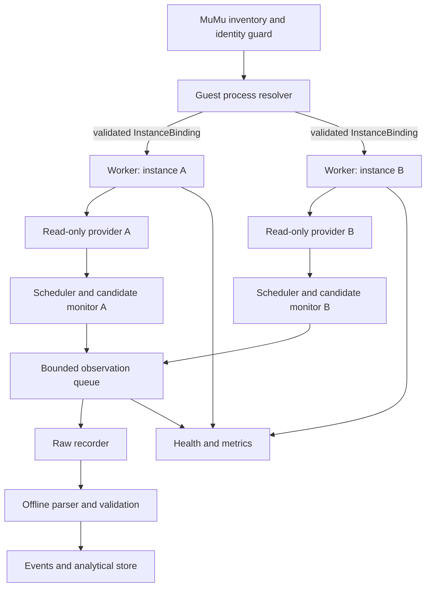
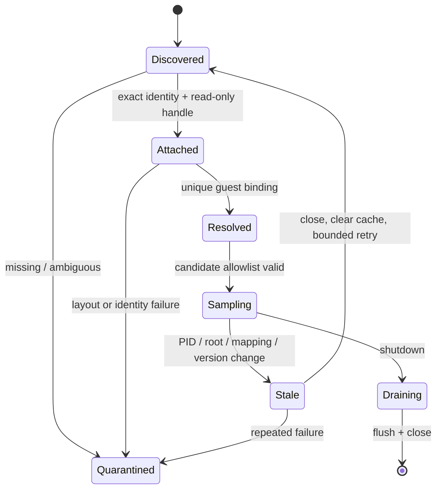

# 03 — System architecture

## Components and interfaces

The **inventory** polls MuMu CLI with a timeout and derives an instance key from the exact display name plus MuMu's stable instance identifier if one is verified. VM index and host PID are generation-scoped. An `InstanceBinding` contains inventory timestamp, name/index, VMM PID and creation time, executable path/command line fingerprint, ADB endpoint (for validation only), guest package/PID/version, and an acquisition generation UUID. Missing or duplicate names fail closed. Dynamic add/remove creates or cancels only that instance's worker.

The **resolver** validates the chain `instance → VMM PID → guest root/address space → package process`. Since upstream enumeration identifies ELF-bearing address spaces rather than Android PIDs, it must return `Ambiguous` until independent correlation is demonstrated. On any changed PID, creation time, root, module layout, package version, or generation, all candidate addresses and caches become invalid.

The **provider** is a pure read-only interface: `Attach(binding) -> Result<Session>`, `Discover(session, expected) -> Result<GuestSpace>`, `ReadExact(guestSpace, range, maxBytes) -> Result<ByteBuffer>`, `Invalidate`, `Close`. It returns typed errors (`AccessDenied`, `AmbiguousInstance`, `LayoutUnknown`, `Unmapped`, `PartialRead`, `StaleGeneration`, `Cancelled`, `BudgetExceeded`) plus duration and bytes actually read. It cannot expose write calls. A mock provider drives scheduler/parser tests without MuMu. The underlying process handle is opened with query/read rights only and held by RAII. Never share a `Target` across instance workers.

The **scheduler** uses a per-instance monotonic clock, configured intervals, deadlines, read-byte limits, region allowlists, and cancellation tokens. It samples validated candidates only; broad scanning is an explicit offline experiment with separate limits. No automatic adaptive sampling until validated event lifetimes justify it. The **monitor** stores prior sample hashes/bytes within a fixed budget and emits change observations; it never assigns combat meaning. The **raw recorder** writes append-only session and observation records with commit/checkpoint boundaries. The **parser** consumes recorded bytes offline and produces versioned candidate events, with every field linked to source observations. The **health service** reports latency, CPU, queue fill, failures, drops, restarts and version drift.

## Concurrency and fault handling

One supervisor owns inventory, one isolated worker owns each instance/provider, and a bounded writer pool owns storage. Each worker has its own queue, limits and restart backoff. A fatal translation error terminates that worker, not the process. Queue saturation emits `dropped_observations` with interval and count; it never silently blocks a game-facing worker indefinitely or allocates without bound. Shutdown stops scheduling, drains with a deadline, records any unflushed count, checkpoints SQLite, and closes handles. Crashes are recovered from durable session records; incomplete intervals stay explicitly incomplete. The acquisition layer contains no Dragonfire-specific parser, and application parsers receive only recorded observations and versioned candidate definitions.

Configuration is versioned and names exact allowed instances/packages; defaults prohibit all collection. Guardrails include maximum bytes/read, bytes/sec, samples/sec, retained bytes/session, discovery timeout, queue size, disk quota and permitted regions. A configuration schema rejects unknown keys and unsafe zero/unlimited values. Resource budgets for 1, 2, 4 and 8 instances are determined by the benchmark in [08](08-VALIDATION-AND-TEST-PLAN.md), never inferred from a single-worker result.

An implementable configuration envelope is `schema_version`, `allowed_instances[]` (exact display name plus optional verified instance key), `allowed_packages[]`, `candidates[]` (locator version, region constraints, maximum bytes, interval), `limits` (per-read, per-second, per-session, queue and disk), `storage_root`, and `retention_days`. Reject a candidate whose sampling interval is below the measured p95 acquisition time. Persist the config hash in every session. The supervisor's reconciliation loop computes a set difference between desired and verified live instances; it never auto-attaches to an unknown new instance.

| Running workers | Benchmark setup | Budget decision |
|---|---|---|
| 1 | Establish per-worker CPU, RAM, read latency, frame-time and I/O baseline. | Set provisional caps below measured saturation. |
| 2 | Run independently timed workers; force one restart. | Verify no cross-instance address reuse and no shared failure. |
| 4 | Repeat with mixed intervals and one slow writer. | Size per-worker queues and global storage bandwidth from observed peaks. |
| 8 | Run only if eight authorized research instances exist and host capacity permits. | Admit or reject this scale based on measured frame-time and resource gates; do not extrapolate success. |
