# MuMu host-memory telemetry: master plan

Status: planning and source audit, 2026-10-16 (America/Los_Angeles). No collector or host-memory probe has been run. The reference source is pinned at commit `de6fc62a868c52f21b0f059f4c53e75b10f2f809`. Its local clone is in the ignored `Game_Details/Resources/_snapshots/mumu-memory-reference-audit/` folder. All project evidence remains local to the user's authorized `TrikePistol` research instance.

## Decision

**CONDITIONAL GO for a bounded read-only compatibility prototype; NO GO for continuous combat collection yet.** Source inspection establishes a plausible Windows-host reader, not MuMu 6.8.5.0 compatibility or the existence of reconstructible combat records. The original library cannot be used unchanged: it requests `PROCESS_VM_WRITE | PROCESS_VM_OPERATION` and exports write functions. Build a minimal read-only fork for M1, retaining proven discovery code only after tests. A public wrapper alone does not remove the write-capable process handle.

On this host, `mumu-cli.exe version` returned `6.8.5.0`. `info --vmindex all` identified stopped `Bikeknife` (index 0) and running `TrikePistol` (index 1, endpoint `127.0.0.1:16416`, MuMu-reported host PID 31272). The guest reports Android 15 and ABIs `x86_64,arm64-v8a,x86`; the game reports `primaryCpuAbi=arm64-v8a`, version `26.10.57632` / code 337, and guest PID 6238 during this inspection. These identifiers are observations, never constants. Host process metadata maps PID 31272 to `MuMuNxDevice.exe` with command line `-v 1 --vm MuMuPlayerGlobal-15.0-1`; this is a promising per-instance link, not proof of the guest-RAM layout. ADB was disconnected after the read-only query. No VM or game lifecycle was changed by the agent.

```mermaid
flowchart LR
  CLI[MuMu CLI inventory] --> ID[Instance identity gate]
  ID --> H[Windows PID and creation-time check]
  H --> P[Read-only memory provider]
  P --> S[Bounded sampler]
  S --> O[Raw observations + provenance]
  O --> E[Offline candidate analysis]
  E --> V[Independent validation]
  V --> N[Normalized events]
  N --> A[Combat analysis]
```

## Critical path and gates

1. **M0 audit:** source review complete for planning; clone/build provenance and defects in [01](01-REFERENCE-LIBRARY-AUDIT.md). Confirm a reviewable read-only fork before any live attach.
2. **M1 compatibility:** explicit `TrikePistol` identity and host PID, least-privilege handle, small known non-sensitive reads, repeatability, and restart rejection. Failure means NO GO for this backend. [02](02-ENVIRONMENT-AND-COMPATIBILITY.md).
3. **M2–M3 observation:** only selected bounded ranges; controlled phases and comparison against independent game-visible annotations. No combat-data claim until repeatable evidence. [04](04-MEMORY-DISCOVERY-METHODOLOGY.md).
4. **M4 reconstruction:** a parser is introduced only for verified structures with duplicate/missed-sample accounting. [06](06-ANALYSIS-AND-RECONSTRUCTION.md).
5. **M5–M8 operation:** continuous workers, multi-instance isolation, storage, analytics, soak tests. [03](03-SYSTEM-ARCHITECTURE.md), [05](05-DATA-MODEL-AND-STORAGE.md), [07](07-IMPLEMENTATION-ROADMAP.md), [08](08-VALIDATION-AND-TEST-PLAN.md).

See [09](09-OPEN-QUESTIONS-AND-ASSUMPTIONS.md) for unresolved decisions. A valid telemetry result must carry a path from analysis row to event, source observation, acquisition session, instance/process identity, parser version, and evidence status. Memory presence alone does not establish an event's meaning or completeness. Game-client evidence is separate from canonical Dragonfire mechanics; there is no automatic promotion into `data/`, the Strategist, or combat findings.

## Scope and constraints

Host-side reads may affect VMM scheduling, page residency, and performance. Neither invisibility nor zero interference is claimed. No write-capable handle, injection, Android agent, root dependency, network interception, anti-cheat evasion, broad continuous dump, or protected `Bikeknife` research is in scope. If a protection prevents reading, record the limitation. Starting additional instances or battles belongs to controlled non-competitive experiments on `TrikePistol` only.

## Source basis

- [Pinned reference source](https://github.com/ankitrawatgit/MumuPlayer-External-Memory-RW-Windows/tree/de6fc62a868c52f21b0f059f4c53e75b10f2f809) and [README](https://github.com/ankitrawatgit/MumuPlayer-External-Memory-RW-Windows/blob/de6fc62a868c52f21b0f059f4c53e75b10f2f809/README.md).
- [Microsoft process access rights](https://learn.microsoft.com/en-us/windows/win32/procthread/process-security-and-access-rights) and [VirtualQueryEx](https://learn.microsoft.com/en-us/windows/win32/api/memoryapi/nf-memoryapi-virtualqueryex).
- [MuMu official multi-instance guide](https://www.mumuplayer.com/help/win/multi-instance-guide.html); the installed `mumu-cli.exe` help and live output establish the more specific local CLI behavior.
